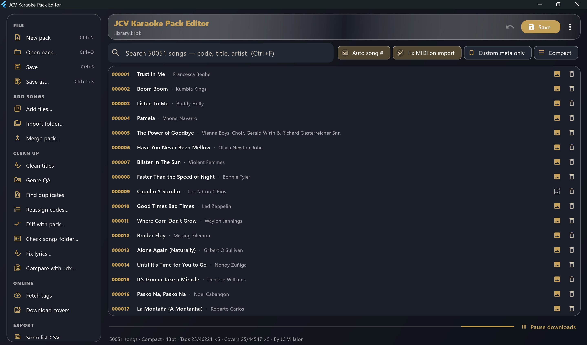
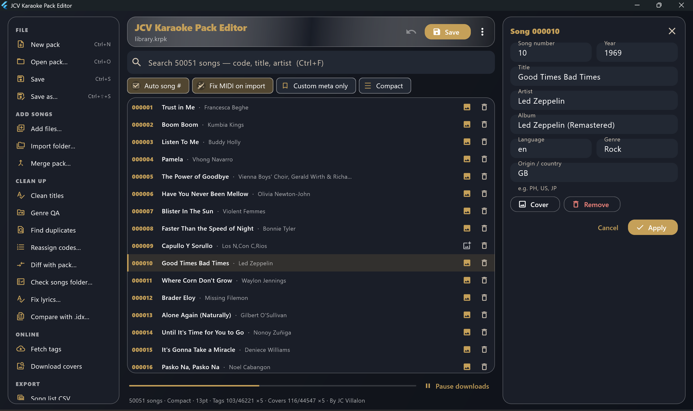
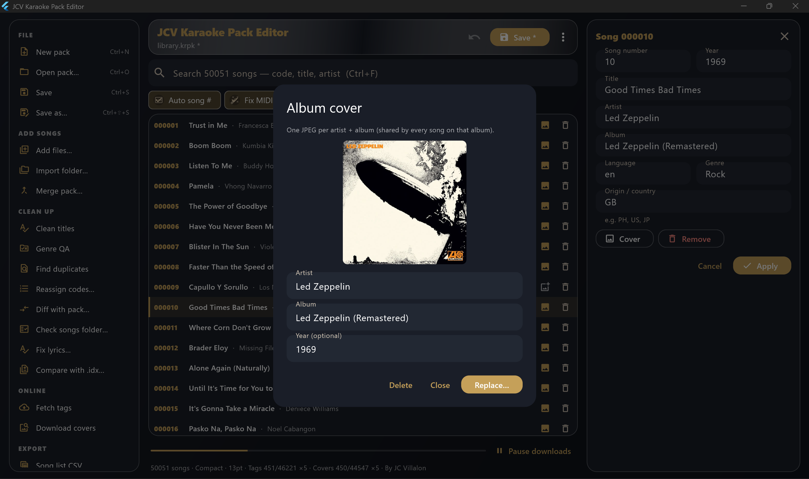

<p align="center">
  
</p>

<h1 align="center">JCV's Karaoke Pack Editor</h1>

<p align="center">
  
  
  
</p>

<p align="center">
Create, open, and maintain open karaoke packs — <strong>.krpk</strong> song libraries and sibling <strong>.krcp</strong> album covers — for <strong>JCV's Karaoke</strong>. Built for large libraries (tens of thousands of songs), folder import, metadata cleanup, cover bake, and CSV / song-book export.
</p>

> **Status:** Preview page — screenshots and feature overview first. **Source code will be published after review.** Build scripts below describe the upcoming tree.

## 📊 Features & Screenshots

### 💻 Main window (Windows desktop)


_Dark theme · Compact list · search across ~50k songs · full toolbar for pack ops, QA, covers, and export._

### ✏️ Edit song


_Code, title, artist, album, plus pack extra JSON: year, language, genre, origin / country._

### 🖼️ Album cover


_One JPEG per artist + album (shared by every song on that album). Preview, Replace, or Delete._

### 🔍 Key capabilities

- **📁 Pack file ops:** New / Open / Save / Save As `.krpk`, unsaved `*` marker, discard prompt, drag-drop or **Add files** (MIDI / KAR / MP3)
- **📥 Import folder:** Recursive scan, unused song #, CRC skip if already in pack, preview with editable tags / origin before Import
- **🔢 Auto song #:** Allocate unused codes from filenames or sequential numbering
- **🔎 Find dupes:** Code / title+artist / CRC duplicate scan
- **🔀 Merge & Diff packs:** CRC-dedupe merge from another `.krpk`; CRC index diff (added / removed / changed tags)
- **♻️ Reassign codes + Undo:** Bulk renumber with an undo stack covering clean / merge / bulk / save-related edits
- **✨ Clean titles:** Local Title Case + artist spelling; optional MusicBrainz
- **🎚️ Genre QA:** Religious denylist preview — clear false-positive genre tags
- **🏷️ Fetch tags:** Opt-in iTunes lookup (title / artist / album / genre / year) with preview
- **🎨 Covers pack (`.krcp`):** Opt-in cover fetch, per-row preview/edit, **Save covers pack** / **Export covers…**, baked beside `.krpk` on Save
- **🗃️ Custom meta DB:** Sparse `custom_meta.sqlite` by payload CRC32 — Seed DB / Export custom CSV / revert; Save bakes into pack
- **📤 Export CSV:** `song_list.csv` + `song_tags.csv` (album / year from extra)
- **📖 Song book…:** Printable PDF list
- **🎛️ Appearance:** Compact density, font size, Dark / Light / OLED themes, online toggles, custom meta DB path
- **🧩 Shared format core:** Same open pack library as the player — KRPK / KRCP layout stays in sync

| Toolbar | What it does |
| :--- | :--- |
| New / Open / Save / Save As | Pack lifecycle |
| Add files / Import folder | Bring in MIDI · KAR · MP3 |
| Export CSV / Seed DB / Export custom CSV | Lists + custom meta DB |
| Find dupes / Merge pack / Diff pack | Integrity & multi-pack ops |
| Reassign codes / Undo | Bulk codes + undo stack |
| Clean titles / Genre QA / Fetch tags | Metadata QA |
| Covers / Save covers pack / Export covers… | `.krcp` album art |
| Song book… | PDF catalog |
| Auto song # / Has custom meta / Compact | Mode toggles |

## 📦 Pack formats

### KRPK — song pack

One randomly accessible file: **catalog index + MIDI/MP3/KAR payloads**. Magic `KRPK`, little-endian header, seekable index by song code, optional zlib payloads, CRC32 of raw payload. Extra UTF-8 JSON per entry for album / year / country (and more).

```
Offset  Field
0       "KRPK"
4       u16 version (=1)
6       u16 flags (bit0 = zlib payloads)
8       u32 songCount
12      u32 indexBytes
16      u64 payloadOffset
32…     index entries (code, title, artist, language, genre, mediaType, sizes, crc32, extra…)
payloadOffset…  concatenated song blobs
```

### KRCP — covers pack

Sibling file keyed by **artist + album** (not song code). Magic `KRCP`, same header skeleton; payloads are center-square JPEG (~512px). Ship next to the song pack:

```
library.krpk
library.krcp
```

Full binary layout docs ship with the source release.

## 🚀 Installation & Setup

> Build scripts and Flutter project land with the **source upload** (after review). Outline below is what the published tree will use.

### Prerequisites

* 🧰 **Flutter** SDK on `PATH` (desktop + Android tooling as needed)
* 🪟 **Windows:** Visual Studio C++ desktop workload for Windows builds
* 🤖 **Android:** Android SDK / Studio for APK builds (`ANDROID_HOME` or default Studio SDK)
* 🍎 **Mac:** Xcode + Flutter macOS desktop enabled

### Windows (recommended)

```bat
REM Rebuild Debug and launch
run-windows.bat

REM Launch existing Debug build only
run-windows.bat run

REM Rebuild Release and launch
run-windows.bat release
```

| Script | Purpose |
|--------|---------|
| `run-windows.bat` | `flutter build windows --debug`, then launch the Debug exe |
| `run-windows.bat run` | Launch existing Debug exe (no rebuild) |
| `run-windows.bat release` | Rebuild Release, then launch |

### Android APK

```bat
REM Clean + release split-per-abi, then open output folder
build-apk.bat

build-apk.bat debug
build-apk.bat universal
build-apk.bat noclean release
```

| Arg | Effect |
|-----|--------|
| *(none)* | Clean + release **split-per-abi** |
| `debug` / `release` | Choose mode |
| `universal` | Single fat APK |
| `noclean` | Skip `flutter clean` |

### Mac

```bash
flutter pub get
flutter run -d macos
# or
flutter build macos
```

## 👥 Community & Support

### Getting Help

- **Issues:** [GitHub Issues](https://github.com/jcvsite/Karaoke-Pack-Editor/issues) for bug reports and feature requests
- **Discussions:** [GitHub Discussions](https://github.com/jcvsite/Karaoke-Pack-Editor/discussions) for questions

❤️ **Support:**

This project was created and is maintained by **JC Villalon** ([@jcvsite](https://github.com/jcvsite)). It's a personal project provided "as is", and while I aim for it to be useful, I cannot guarantee timely support or fixes for all issues.
If you use any information or code from this project, please consider giving credit by linking back to this repository and starring it on GitHub!

*   **Primary Method:** Please **open an Issue** on the GitHub repository for bug reports, questions, or feature requests.
*   **🐛 Bug Reports:** Include:
    *   Platform (Windows / Android / Mac) and Flutter version (once source is published)
    *   A clear description of the problem and steps to reproduce it
    *   Screenshots if applicable

*   If you find this project useful, consider showing your appreciation:
    *   [Buy Me a Coffee](https://coff.ee/jcvsite)
    *   [PayPal](https://paypal.me/jcvsite)

🤝 **Contributing:**

Contributions will be welcome once the source tree is published.

**By JC Villalon**

---

**GitHub**: [https://github.com/jcvsite/Karaoke-Pack-Editor](https://github.com/jcvsite/Karaoke-Pack-Editor)

Open pack formats (**KRPK** / **KRCP**) and this editor are part of the **JCV's Karaoke** project.
